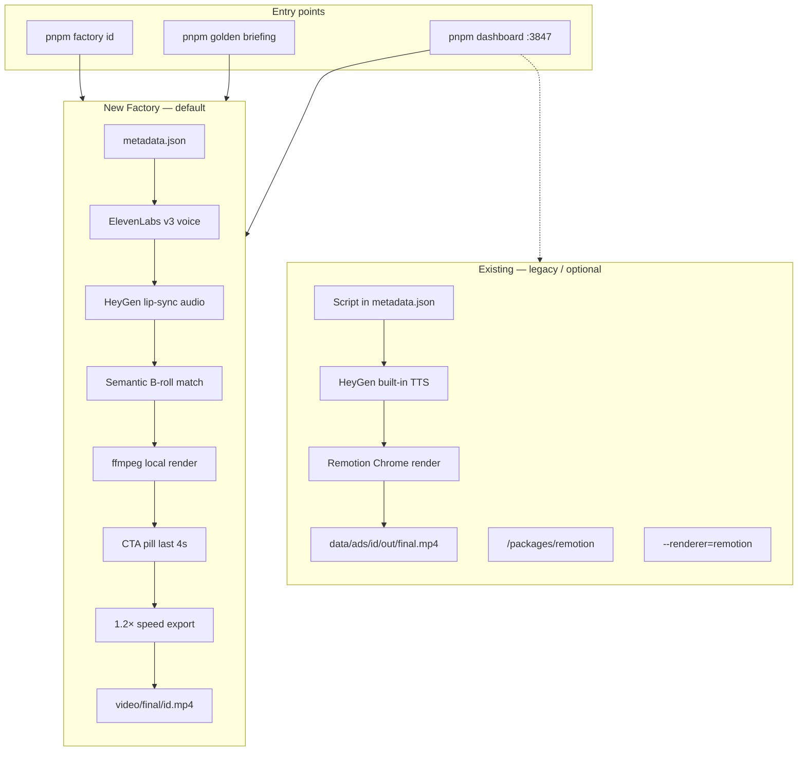
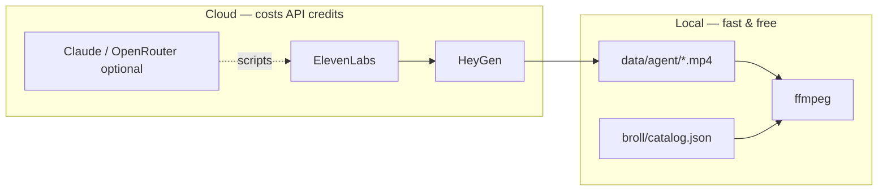
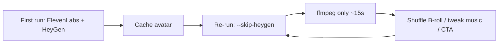

# Architecture Plan — AI Ad Factory

> Visual companion: open [architecture-plan.canvas.tsx](/Users/piyush/.cursor/projects/Users-piyush-sandan-video-agent/canvases/architecture-plan.canvas.tsx) beside this doc.

---

## Goal

Ship a **repeatable video factory**: user provides a German script + avatar choice → get a **production-quality 9:16 Meta ad** (avatar, semantic B-roll, karaoke captions, music, CTA button) in **under a minute** on re-edits — **no Remotion/Chrome for the main path**, no HeyGen robot voice, built to scale to **thousands of videos** with cached avatars.

---

## Architecture — Two pipelines, one platform



---

## Entry points

| Surface | Command / URL | Role |
|---------|---------------|------|
| **Factory CLI** | `pnpm factory <id>` | Main path — full or `--skip-heygen` re-edit |
| **Dashboard** | `pnpm dashboard` → `:3847` | Edit script, avatar, music, captions; trigger render |
| **Golden path** | `pnpm golden briefing.json` | Claude writes scripts → approve → multi-variant ads |
| **B-roll sync** | `pnpm factory --sync-broll` | Index `~/Downloads/B-Roll` → catalog |

---

## Existing — legacy (untouched, still available)

```
script  →  HeyGen text TTS  →  Remotion frame render  →  final.mp4
                (robot voice)      (Chrome, minutes)
```

| Piece | Location |
|-------|----------|
| Remotion composition | `packages/remotion` |
| Enable | `pnpm produce <id>` (no `--renderer=ffmpeg`) |
| When to use | Pixel-perfect caption experiments, Remotion Studio preview |

---

## New Factory — default production path

```
metadata.json
    →  ElevenLabs v3  (main.mp3 + word timestamps)
    →  HeyGen audio mode  (data/agent/<id>/main.mp4 — cached)
    →  Beat plan  (5s avatar → B-roll cuts ~1.4s)
    →  Semantic B-roll  (script words → Trading / Lifestyle / …)
    →  ffmpeg compositor  (~10–30s)
    →  CTA overlay  (blue pill → arrow → white pill)
    →  1.2× speed
    →  video/<session>/ + video/final/
```

| Piece | Location |
|-------|----------|
| Orchestrator | `packages/pipeline/src/factory.ts` |
| ffmpeg render | `packages/pipeline/src/ffmpeg-render.ts` |
| B-roll match | `packages/pipeline/src/broll-match.ts` |
| CTA button | `packages/pipeline/src/cta-overlay.ts` |
| Enable | `pnpm factory <id>` or `--renderer=ffmpeg` |

---

## External services vs local



---

## Re-edit strategy (scale)



---

## Folder map (one glance)

| Path | What |
|------|------|
| `data/ads/<id>/metadata.json` | Recipe |
| `data/agent/<id>/main.mp4` | Cached HeyGen avatar |
| `data/broll/catalog.json` | 170+ clips indexed |
| `video/17th June/` | Session batch output |
| `video/final/` | Latest deliverable copy |

---

## Defaults (factory)

| Setting | Value |
|---------|-------|
| Intro (avatar only) | 5 s |
| B-roll cut | ~1.4 s |
| Music | 30% under voice |
| Captions | ALL CAPS, large |
| Speed | 1.2× |
| CTA | Last 4 s — blue → white on click |
| Renderer | ffmpeg |

---

## Docs index

| Doc | Audience |
|-----|----------|
| [Simple-Overview.md](./Simple-Overview.md) | Onboard anyone — glossary + flows |
| [FACTORY_FLOW.md](./FACTORY_FLOW.md) | Technical factory reference |
| **Architecture-Plan.md** (this file) | Plan-style architecture snapshot |
| [HEYGEN_AVATARS.md](./HEYGEN_AVATARS.md) | Avatar IDs & selection |
