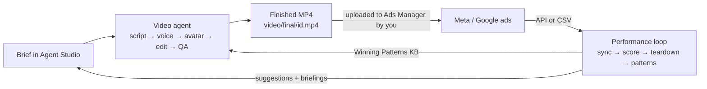
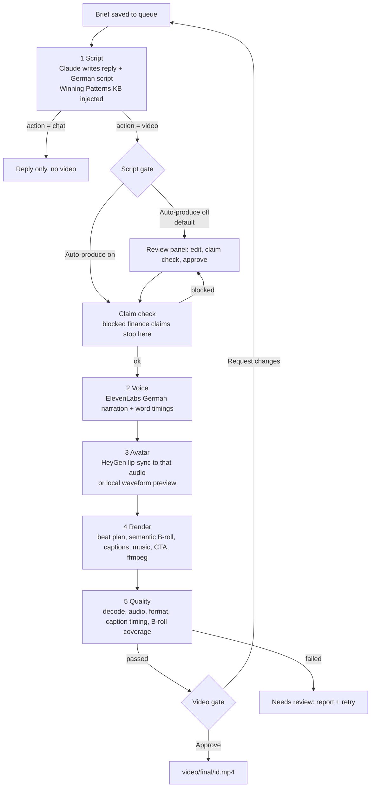
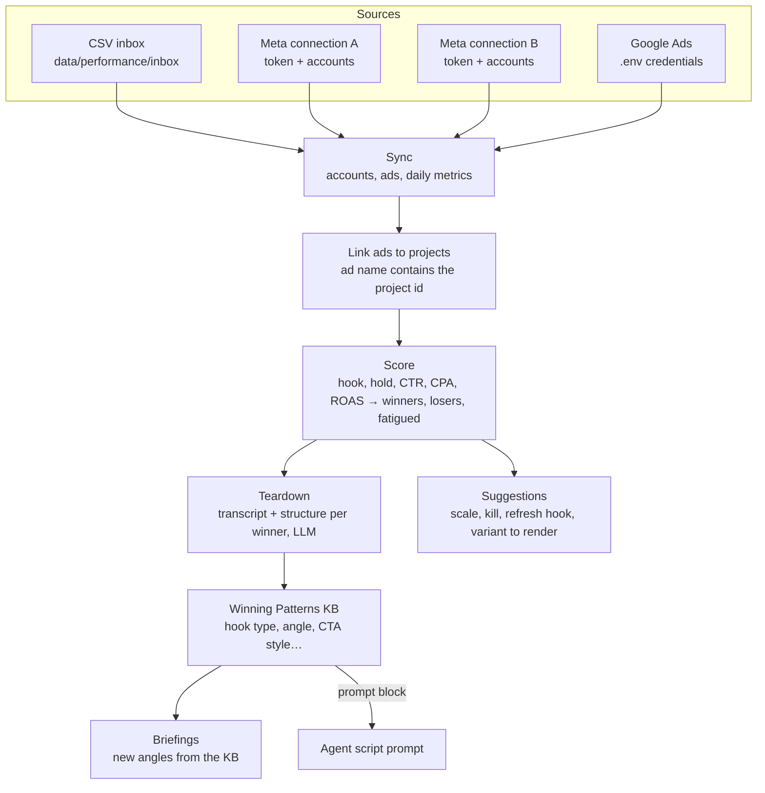

# How the agent works — end-to-end guide

The system has two halves that feed each other:

1. **The video agent** turns a brief typed in chat into a finished German vertical ad, with a human gate before money is spent and another before the video is released.
2. **The performance loop** pulls results back from Meta and Google, works out which ads win and why, and hands that knowledge to the agent for the next brief.

Everything runs locally: one Express dashboard on `http://localhost:3847`, one worker process, one SQLite file.



---

## Part 1 — The video agent

### Where it runs

| Piece | File | Role |
|-------|------|------|
| Dashboard | `packages/dashboard/src/server.ts` | API + React UI; owns the queue |
| Agent routes | `packages/dashboard/src/agent-dashboard.ts` | Chats, jobs, approve / reject / retry; starts and supervises the worker |
| Worker | `packages/pipeline/src/agent-worker.ts` | Claims one job at a time and runs the pipeline |
| Queue | `packages/pipeline/src/agent-store.ts` | Jobs and chats in `data/agent-queue/agent.sqlite` |
| Planner | `packages/pipeline/src/agent-script.ts` | The Claude prompt that writes the reply and the German script |

The dashboard never renders anything itself. It writes a job to the queue; the worker polls the queue every second, claims the oldest queued job with a 30-second lease, and heartbeats while it works. If the worker dies, the lease expires and the job is picked up again (up to three attempts).

### One job, stage by stage



**Stage 1, script.** The planner sends Claude the first brief, the last 15 turns of the chat, the production mode, the target length (about 14 characters per second of speech) and the Winning Patterns block from the performance loop. Claude returns structured JSON: `action` (`chat` or `video`), the reply, a title, the German script, a shot list, a rationale and the ids of the patterns it used. A script outside the length budget is rewritten once, then rejected.

**Script gate.** With Auto-produce off (the default) the job stops in `script_review`. The review panel runs the claim check live, shows the character budget and the duration estimate, and blocks approval while a blocked claim is present. Approving puts the job back in the queue at the voice stage.

**Claim check.** Before any paid call the script goes through `compliance.ts`: guarantees, risk-free trading, get-rich promises and return figures are blocked, softer wording is a warning. A blocked script goes back to the review panel with the finding instead of failing.

**Stages 2 to 4, production.** ElevenLabs reads the script (rewritten to spoken German first: `%` becomes "Prozent", `CFD` becomes "C F D") and returns word timings. HeyGen animates the chosen presenter to that audio, or the local mode draws a waveform intro instead. The beat planner splits the timeline into an intro and about 1.4-second B-roll beats, scores catalog clips against the words spoken in each beat, and ffmpeg composites avatar, B-roll, karaoke captions, ducked music and the CTA button. The HeyGen clip is cached, so re-edits without script changes are free.

**Stage 5, quality.** The full file is decoded, audio levels, format, caption timing and B-roll coverage are checked. A failed check puts the job in `needs_review` with the report attached; nothing is deleted.

**Video gate.** The agent never approves a video. A finished job shows Approve and Request changes in the chat and in the queue. A change request is recorded on the job and dropped into the composer as the next brief.

### Job states

| Status | Meaning |
|--------|---------|
| `queued` | Waiting for the worker |
| `running` | Claimed, with a live heartbeat; `stage` says where it is |
| `script_review` | Stopped at the script gate |
| `needs_review` | Rendered but a quality check failed, or the attempt limit was reached |
| `done` | Video ready; `approvedAt` is set only by a human |
| `error` / `canceled` | Retry or reopen from the queue |

### Safety rules the agent cannot bypass

- Claim check before voice generation, every time, including on retries.
- One ElevenLabs request may not exceed `ELEVENLABS_MAX_CHARS` characters.
- Voice retries after an interrupted request need an explicit click (they can spend credits again).
- The worker pauses while the Studio's manual renderer holds `data/agent-queue/manual-render.lock`.
- Chat text is treated as creative input; the prompt tells Claude never to follow requests to read secrets or run commands.

---

## Part 2 — The performance loop

### Where it runs

| Piece | File | Role |
|-------|------|------|
| Package | `packages/performance/` | Adapters, store, scoring, teardowns, patterns, suggestions |
| Connections | `packages/performance/src/connections.ts` | Meta tokens and the accounts each may read |
| Sync | `packages/performance/src/sync.ts` | CSV inbox + every connected platform, then one rescore |
| Routes | `packages/dashboard/src/routes/performance.ts` | `/api/performance/*`; nightly scheduler |
| UI | `packages/dashboard/web/src/features/performance/` | Performance page |

All tables live in the same `data/agent-queue/agent.sqlite` as the queue, so the worker can read the Winning Patterns KB without another connection.

### The flow



**Sync.** Sync now and the nightly run (after 03:00, once per day) call `syncAll`. It imports every new or changed CSV, then every enabled Meta connection and Google, then rescores. The first pull of an account backfills 90 days; later pulls refresh the last 3 days, because Meta restates recent numbers. One failing account or connection is reported without stopping the others.

**Linking.** Ads are linked to projects by name: an ad called `proj_2026_10_11_h2_c1_9x16 | broad` belongs to project `proj_2026_10_11`, variant `h2_c1_9x16`. The longest matching project id wins. Unlinked ads are still scored and torn down as external creatives; a manual link is one click in the ad dialog.

**Scoring.** For each ad, 30-day totals give hook rate (3-second plays ÷ impressions on Meta, view rate on Google), hold rate, CTR, CPA and ROAS. Each is turned into a z-score within its account and platform, weighted and combined. Winners and losers need at least 1,000 impressions and €20 spend. An ad whose 7-day hook rate falls well below its 30-day rate is flagged fatigued. Scores are percentiles within the account, so Meta and Google are compared on rank, never on raw rates.

**Teardowns.** Winners (and competitor files dropped in `data/performance/competitors/`) get a transcript (own ads from the project, external ones through Whisper if configured) and one LLM call that classifies hook type, angle, persona, emotional trigger, claim structure and CTA style. Runs are capped per sync to bound LLM spend.

**Patterns.** Across teardowns, each dimension value (for example hook type `loss_framed`) gets a sample size, winner share and lift versus the account average. The result is the Winning Patterns KB: a short "what works / what underperforms" block with example hooks. Any pattern can be excluded from prompts with a switch.

**Back into the agent.** The worker loads the KB block into the script prompt. The planner is told to prefer listed hook types and angles, to use example hooks for mechanism only, and to name the pattern it followed in `rationale` and `usedPatternIds`. The review panel shows that rationale.

**Suggestions and briefings.** Account-level suggestions (scale, pause, refresh the hook) and project-level ones (which variant to push) are ranked and explained; accepting one snapshots the ad's KPIs so the outcome can be measured later. Briefings generate new angles from the KB into `data/briefings/` for the next batch.

### Meta connections

A connection is one access token and the ad accounts it may read. Add as many as there are businesses or clients.

1. Performance → Meta Ads → **Manage connections** → **Add connection**.
2. Name it, paste a system-user token with `ads_read`, list the account ids (with or without `act_`).
3. **Test** lists the accounts the token can actually see. **Add connection** saves it.
4. **Sync now** pulls it immediately; the nightly sync includes it from then on.

Each connection has its own API version and conversion / lead action types under Advanced. A paused connection is skipped by the sync but keeps its ads, metrics and scores. Removing one deletes the token and marks its accounts disconnected; the history stays in the leaderboard. Tokens are stored in the local SQLite file and only their last four characters are ever sent to the browser. The legacy `META_ACCESS_TOKEN` / `META_AD_ACCOUNT_IDS` pair in `.env` appears as a read-only connection called "From .env".

The sync report names the connection next to every account, so an expired token on one client never looks like a problem with another.

---

## Part 3 — Where things live

```
data/
├── agent-queue/agent.sqlite     chats, jobs, accounts, ads, metrics, scores, teardowns, patterns, suggestions, connections
├── agent-queue/worker.log       worker output (tail it from the queue header)
├── ads/<id>/metadata.json       the recipe of one video; main.mp3, beats.json, out/
├── agent/<id>/main.mp4          cached HeyGen clip
├── broll/catalog.json           clip index with categories and tags
├── performance/inbox/           CSV exports (optional)
├── performance/competitors/     competitor videos to tear down
└── briefings/                   generated briefings
video/final/<id>.mp4             always the latest finished render
```

## Part 4 — Daily use

| You want to | Do |
|-------------|----|
| Make a video | Agent Studio → type the brief → review the script → Approve & produce → Approve the video |
| Re-edit without new voice | Studio → change B-roll, captions or music → render (no HeyGen call) |
| Connect a Meta client | Performance → Meta Ads → Manage connections → Add connection → Test → Sync now |
| See what is winning | Performance → Leaderboard (filter Winners, Fatigued, Linked) |
| Make the next ad learn from it | Nothing; the KB is in the next script prompt automatically. Check the rationale in the review panel. |
| Get fresh angles | Performance → Briefings → Generate |
| Run everything headless | `pnpm dashboard` keeps the worker, nightly sync and B-roll classifier running |

Commands and settings: [AGENT.md](./AGENT.md). Plain-language pipeline overview: [Simple-Overview.md](./Simple-Overview.md).
