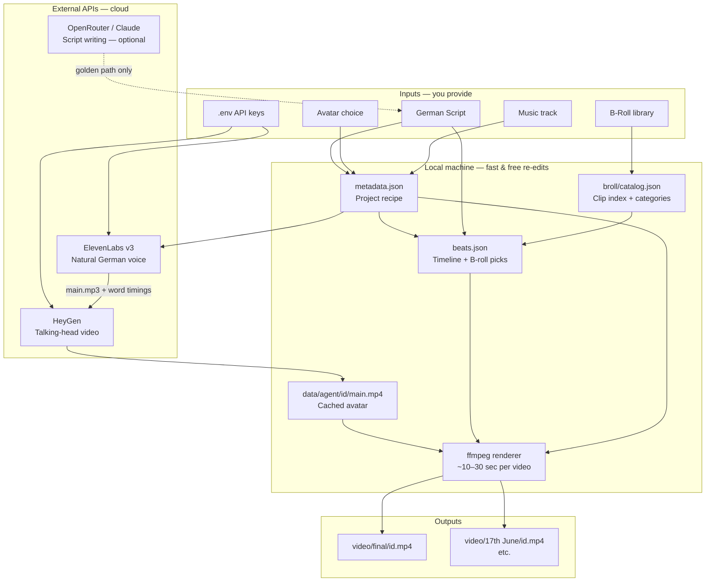
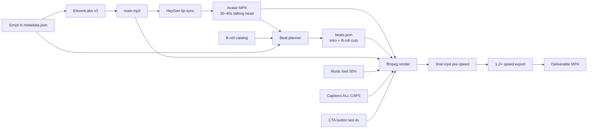
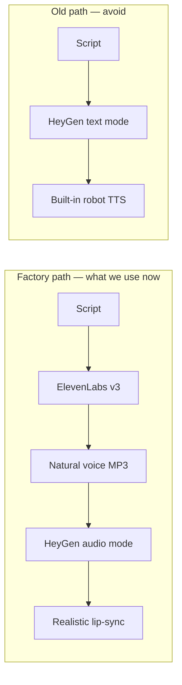
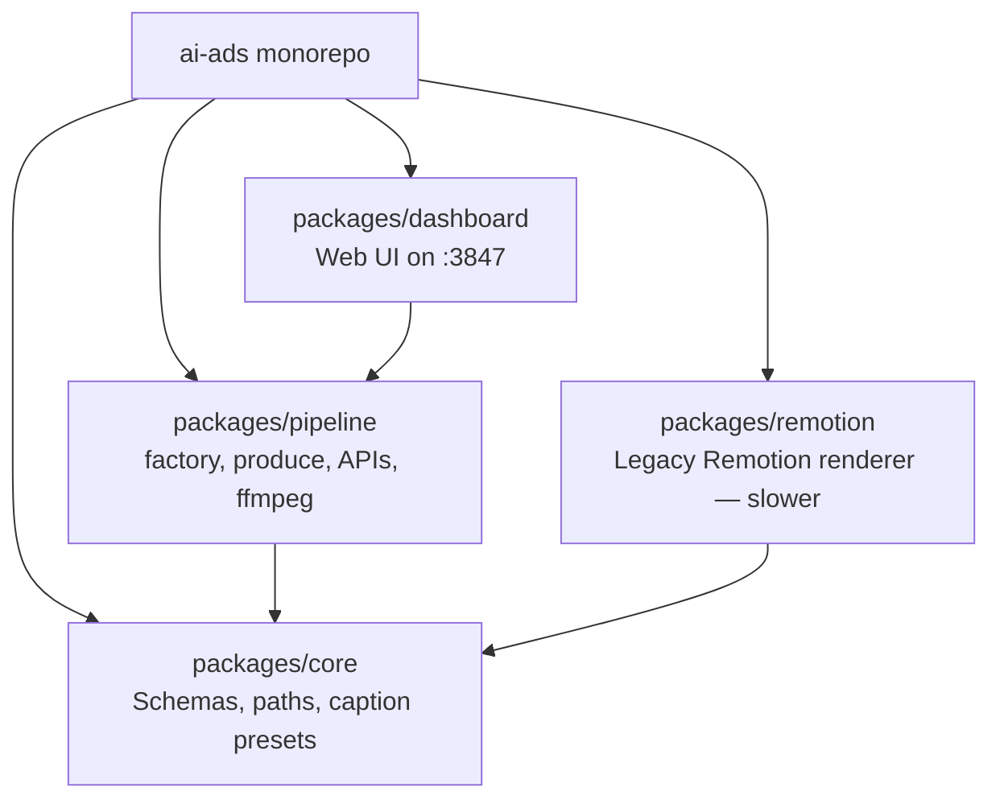
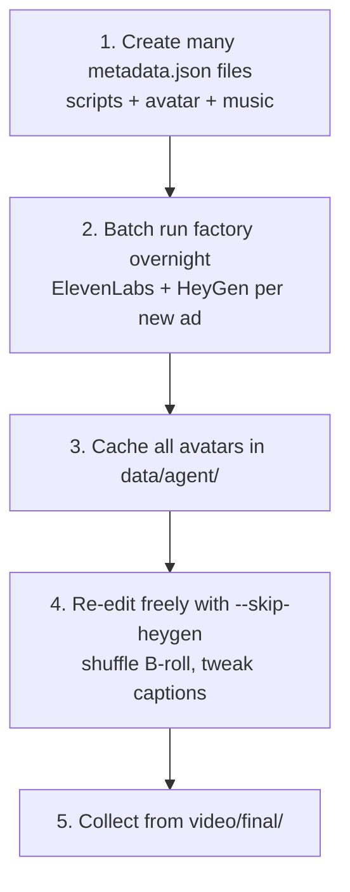

# AI Ad Factory — Simple Overview

A plain-language guide to **what this project does**, **how the pieces connect**, and **how a video gets made**. Share this with anyone who needs the big picture without reading code.

---

## What is this?

We turn a **German ad script** into a **finished vertical video** (Instagram / TikTok / Meta Reels style):

- Talking-head **avatar** (AI-generated face)
- **B-roll** cutaways (charts, lifestyle, laptop, etc.)
- **Karaoke captions** (word-by-word on screen)
- **Background music** (quiet, under the voice)
- **CTA button** in the last 4 seconds (“Klicke unten auf den Link!”)

One video ≈ **25–30 seconds**, portrait **9:16**.

---

## Knowledge graph — who talks to whom

This is the map of **things** (nodes) and **relationships** (edges).



### Node cheat sheet

| Thing | What it is |
|-------|------------|
| **metadata.json** | Recipe for one ad: script, avatar ID, music, caption style, speed |
| **ElevenLabs** | Creates the **voice** (human-like German). Also returns **when each word is spoken** for captions |
| **HeyGen** | Creates the **face video** lip-synced to that voice (does *not* speak with its own robot voice in factory mode) |
| **B-roll catalog** | Index of ~170 clips tagged Trading / Lifestyle / Deep Work / Community |
| **beats.json** | Edit timeline: “0–5s avatar only, then B-roll cuts every 1.4s” |
| **ffmpeg** | Local compositor — stitches layers in seconds (no Remotion/Chrome for factory path) |
| **CTA overlay** | Blue pill button → arrow click → white pill (last 4 seconds) |

---

## Flow — how one video is made

### The 30-second version

1. **Write or reuse a script** (German, ~30s when read aloud)
2. **ElevenLabs** reads it → `main.mp3` + word timestamps
3. **HeyGen** animates the avatar to that audio → `main.mp4` (saved & reused)
4. **Plan the edit**: 5s talking head, then B-roll matched to what’s being said
5. **ffmpeg** composites avatar + B-roll + captions + music + CTA button
6. **Speed up 1.2×** → export to `video/<session>/` and `video/final/`

### Detailed pipeline



### What the viewer sees on screen

```mermaid
gantt
  title Timeline of a typical ad (~28s after 1.2× speed)
  dateFormat X
  axisFormat %S s

  section Video
  Avatar full screen           :0, 5
  B-roll cuts over avatar      :5, 23
  section Audio
  Voice always playing         :0, 28
  Music under voice 30%        :0, 28
  section Overlays
  Karaoke captions             :0, 28
  CTA blue then white button   :24, 28
```



---

## Two speeds of production

| Mode | Command idea | What runs | Time | Cost |
|------|----------------|-----------|------|------|
| **Full build** | `pnpm factory jun17_09` | ElevenLabs + HeyGen + ffmpeg | ~2–5 min | API credits |
| **Re-edit only** | `pnpm factory jun17_09 --skip-heygen` | Reuses cached avatar, ffmpeg only | ~15–30 sec | Free |

Use **full build** when script or voice changes.  
Use **re-edit** when you only change B-roll, captions, music, or CTA.

---

## Where files live

```
sandan video agent/
├── .env                          ← API keys (ElevenLabs, HeyGen, …)
├── data/
│   ├── ads/<id>/
│   │   ├── metadata.json         ← THE RECIPE (script, avatar, settings)
│   │   ├── main.mp3              ← ElevenLabs voice
│   │   ├── beats.json            ← Edit timeline + which B-roll clips
│   │   └── out/final.mp4         ← Render before speed-up
│   ├── agent/<id>/main.mp4       ← HeyGen avatar CACHE (reuse!)
│   └── broll/
│       ├── clips/                ← Symlinked from ~/Downloads/B-Roll
│       ├── previews/             ← Screenshot per clip
│       └── catalog.json          ← Categories + tags for matching
├── video/
│   ├── 17th June/jun17_09.mp4    ← Session folder (by date)
│   └── final/jun17_09.mp4        ← Always-latest deliverable copy
└── ~/Downloads/B-Roll/           ← Original B-roll downloads
    ├── Trading Content/
    ├── Lifestyle & Freiheit Content/
    ├── Deep Work & Fokus Content/
    └── Interaktion & Community Content/
```

---

## How B-roll matching works (simple)

Old way: pick clips in random rotation → often **doesn’t match** the script.

Current way (**semantic match**):

1. Split the timeline into ~1.4s B-roll beats (after the 5s intro)
2. For each beat, read **which words are spoken** in that window
3. Score clips from the catalog:
   - Script about **Trading / charts / money** → Trading clips
   - Script about **freedom / lifestyle** → Lifestyle clips
   - Script about **learning / laptop / focus** → Deep Work clips
4. Pick the best unused clip

Example: *“verlieren Geld… Risikomanagement”* → trading screen B-roll.

---

## How voice works (important)



**Rule:** Voice always comes from **ElevenLabs**. HeyGen only moves the face.

---

## Default settings (factory)

| Setting | Value |
|---------|-------|
| Avatar on screen first | 5 seconds |
| B-roll cut length | ~1.4 seconds |
| Voice volume | 100% |
| Music volume | 30% of original track |
| Caption style | Bold, italic, ALL CAPS, large |
| Final speed | 1.2× |
| CTA | Last 4 seconds — blue button → click → white |
| Renderer | ffmpeg (local) |

---

## Commands someone actually runs

```bash
# One-time: index B-roll from Downloads folder
pnpm factory --sync-broll

# Make a video (full pipeline)
VIDEO_SESSION="17th June" pnpm factory jun17_09

# Re-render without calling HeyGen again
pnpm factory jun17_09 --skip-heygen

# Dashboard (edit script/settings in browser)
pnpm dashboard   # http://localhost:3847
```

---

## Packages (code organization)



**Today’s main path:** `packages/pipeline` → **ffmpeg** (not Remotion) for speed at scale.

---

## Scaling to thousands of videos



**Key insight:** HeyGen is slow and costs money. **Cache the avatar once**, then iterate edits locally for pennies.

---

## Glossary

| Term | Meaning |
|------|---------|
| **Avatar** | AI talking-head video (HeyGen) |
| **B-roll** | Cutaway footage overlaid on the avatar |
| **Beat** | One slice of the timeline (talking head or B-roll) |
| **Factory** | One-command full pipeline (`pnpm factory`) |
| **metadata.json** | Single source of truth for one ad project |
| **skip-heygen** | Reuse existing avatar, skip API call |
| **Session folder** | Dated output batch e.g. `video/17th June/` |
| **CTA** | Call-to-action button at end of video |

---

## Related docs (deeper detail)

- [GUIDE.md](./GUIDE.md) — how the agent and the performance loop work, stage by stage
- [FACTORY_FLOW.md](./FACTORY_FLOW.md) — technical factory reference
- [HEYGEN_AVATARS.md](./HEYGEN_AVATARS.md) — avatar selection
- [AGENT.md](./AGENT.md) — agent/dashboard integration
- [PLAN.md](../PLAN.md) — long-term roadmap
